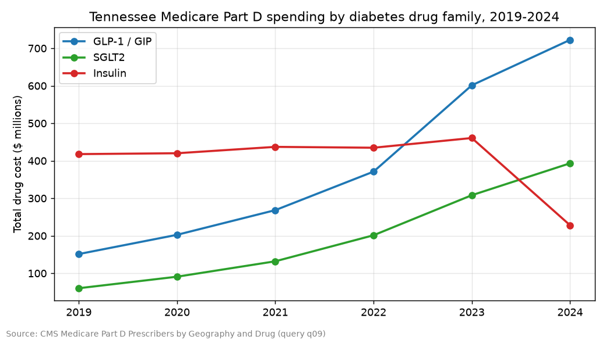
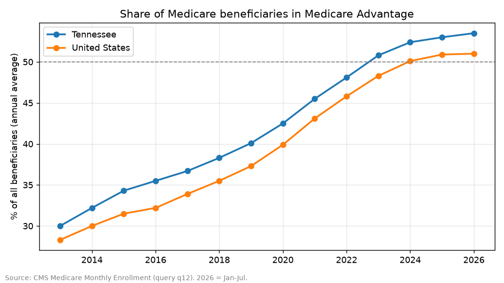

# Findings

Every number here comes from the query outputs in [`results/`](results/RESULTS.md), which CI regenerates from the committed sample on every push. Tennessee is the sample state. Spending is **gross Part D drug cost** (what plans, patients and others paid at the pharmacy, before manufacturer rebates).

---

## A. Diabetes prescribing in Tennessee (Part D, 2024)

**Q01 · Where the diabetes drug dollars go.** Tennessee prescribers in the sample account for **$1.28 billion** of Part D diabetes drug cost over 2.5 million claims. GLP-1 drugs (36.2%) plus the GIP/GLP-1 drug tirzepatide (14.8%) make up **51.0% of the spend but only 21.1% of the claims**. Metformin is the opposite: **29.0% of claims and 0.4% of spend**.

**Q02 · The most expensive drugs.** Ozempic leads at **$336.6M** across 269,580 claims, followed by Jardiance ($224.3M) and Mounjaro ($189.4M). A 30-day fill costs about **$1,039 for Mounjaro and $908 for Ozempic**, against **$73 for Lantus Solostar**.

**Q03 · Who prescribes GLP-1 / GIP drugs.** Primary care physicians write **48.4%** of GLP-1 / GIP claims, and nurse practitioners and PAs write **41.8%**. Endocrinologists write only 7.4%, but each one averages **425 claims**, against 121 for a primary care physician.

**Q04 · City patterns.** In all five of the largest prescribing cities, metformin ranks first by claims, at 26–31% of each city's diabetes claims. Nashville is the only one of the five where GLP-1 drugs rank ahead of SGLT2 inhibitors (19.0% vs 16.8%).

**Q05 · Generic-dispensing rate (all drugs).** Among specialties with at least 50 prescribers, endocrinology (43.9%) and pulmonary disease (44.3%) have the lowest generic rates, apart from pharmacists (6.7%). That fits their reliance on brand-only insulin analogs, GLP-1s and inhalers.

**Q06 · A care-gap screen (anti-join).** Of 2,513 Tennessee nurse practitioners whose Medicare panel is at least 40% diabetic, **1,711 (68.1%)** have no published diabetes-drug rows. For internal medicine the share is 71.0% (707 of 996). *Caveat:* CMS publishes a prescriber-drug row only when it has 11 or more claims, and many of these clinicians are probably hospital or facility based. This is a list to investigate, not evidence of under-treatment.

**Q07 · Spend concentration.** GLP-1 / GIP spending is concentrated. The **top 10% of prescribers (477 people) account for 38.1%** of it, and the top 1% (48 people) account for 9.3%.

**Q08 · Rural vs metro.** Rural and small-town prescribers use GLP-1 / GIP drugs almost as often as metro prescribers (20.2% vs 21.5% of claims). They lean more on metformin and sulfonylureas (43.3% vs 39.1%), so their average cost per claim is lower ($433 vs $532).

## B. Drug-spending trends, 2019–2024 (Tennessee vs U.S.)

**Q09 · Year-over-year growth.** Tennessee GLP-1 / GIP spending rose from **$151.3M in 2019 to $722.4M in 2024**, and grew 62.0% in 2023 alone. SGLT2 spending grew more than sixfold, from $60.2M to $393.3M. **Insulin spending fell 50.5% in 2024** ($460.7M to $228.1M), almost the same as the national drop of 51.9%. The timing matches the insulin list-price cuts manufacturers made in January 2024. The data shows the drop but not its cause.

**Q10 · Semaglutide and tirzepatide (stored function).** Tennessee semaglutide claims grew from 13,403 in 2019 to **313,632 in 2024**. Tirzepatide went from 5,400 claims in its launch year (2022) to **164,288 in 2024**. Cost per claim stayed between about $1,080 and $1,370 the whole time.

**Q11 · Biggest spending movers (all drugs).** Semaglutide added the most Tennessee Part D spend between 2019 and 2024, **+$384.9M**. Next came apixaban (Eliquis, +$321.0M), empagliflozin (+$208.6M) and tirzepatide (+$200.9M, new since 2019). Four of the top six movers are diabetes drugs.

## C. Medicare enrollment (monthly, 2013–Jul 2026)

**Q12 · Medicare Advantage takeover.** Tennessee's MA share rose from **30.0% (2013) to 53.5% (2026 YTD)**. Tennessee crossed 50% in **2023**, a year before the nation (2024).

**Q13 · Month-by-month.** Tennessee had **1,531,146** Medicare beneficiaries in July 2026, up 1.38% from a year earlier. Growth has slowed from about 1.9% a year in late 2024. January brings the largest jumps (+8,551 in Jan 2025, +5,730 in Jan 2026).

**Q14 · State growth ranking.** From January 2019 to July 2026, Tennessee enrollment grew **13.7%**, ranking **38th of 51** (50 states plus DC). Alaska (+26.9%) and Idaho (+26.5%) grew fastest.

**Q15 · Tennessee vs neighbors.** Tennessee's latest MA share (53.6%) is above the U.S. (51.1%) but below Alabama (61.5%), North Carolina (57.8%), Georgia (56.2%), Kentucky (55.4%) and Missouri (54.5%).

## D. Hospitals (Provider Data Catalog)

**Q16 · Star ratings by ownership.** Rated Tennessee acute care and critical access hospitals average **3.04 stars, against 3.17 nationally**. Nationally, non-profits average 3.32 and for-profits 2.81. In Tennessee, for-profits (3.00) do better than the national for-profit average.

**Q17 · Patient experience vs overall rating.** In Tennessee, the CMS overall star rating and the HCAHPS patient-survey summary star have a **correlation of 0.48**. One-star hospitals average 56.3% "definitely recommend", against 79.2% for five-star hospitals. 35 of the 49 unrated Tennessee facilities have no survey data at all.

**Q18 · Best and worst "would definitely recommend".** 56 Tennessee hospitals have 300 or more completed surveys. Among them, Mountain Home VA Medical Center scores highest (91%) and Vanderbilt Clarksville Hospital lowest (39%).

## E. Part B clinicians and data cleaning

**Q19 · Part B payments by specialty.** Nurse practitioners receive the largest share of Tennessee Part B payments, **$353.5M (15.4%)**, because there are 7,486 of them. The median NP receives $14,208, against $206,976 for the median ophthalmologist.

**Q20 · Credential cleanup.** The raw credential field had **91 different spellings that all meant "MD"** (for example `M.D.`, `MD`, `MD, PHD`), and 8.8% of clinicians had no credential at all. After standardizing, MDs make up 37.1% of Tennessee Part B clinicians, nurse practitioners 21.9% and DOs 3.8%.
