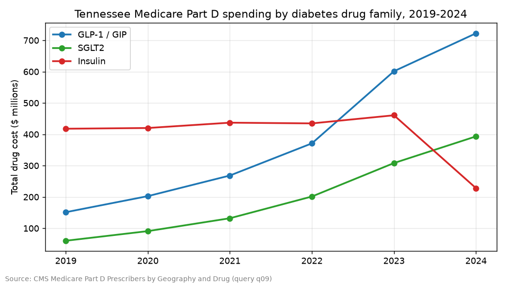
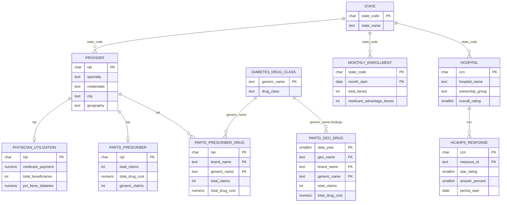

# Medicare Healthcare Analytics in SQL (CMS Public Data)

[](https://github.com/RetnuhFeel/cms-healthcare-sql-analysis/actions/workflows/ci.yml)

An end-to-end **PostgreSQL** project built on official **Centers for Medicare & Medicaid Services (CMS)** data. It loads seven real public datasets as raw text, cleans and types them in SQL, runs automated data-quality checks, and answers **20 business questions** that a healthcare data analyst would get. The focus is diabetes prescribing, drug-spending trends, Medicare enrollment and hospital quality, using **Tennessee** as the sample state.

Everything runs in CI. GitHub Actions starts a fresh Postgres database, loads the sample, runs every data-quality assertion and every query, and checks that the committed results match.

**Quick links:** [Findings](ANALYSIS.md) · [All query outputs](results/RESULTS.md) · [Analysis SQL](sql/05_analysis/) · [Cleaning SQL](sql/02_cleaning/) · [Data-quality checks](sql/03_quality/01_data_quality_checks.sql)

---

## Key findings

| | Finding | Query |
|---|---|---|
| 💊 | GLP-1 / GIP drugs (Ozempic, Mounjaro, Trulicity …) are **51.0% of Tennessee's $1.28B Part D diabetes drug spend but 21.1% of claims**. Metformin is 29.0% of claims and 0.4% of spend. | [Q01](sql/05_analysis/q01_diabetes_spend_by_class.sql) |
| 📈 | Tennessee GLP-1 / GIP spending grew **from $151.3M (2019) to $722.4M (2024)**. Insulin spending **fell 50.5% in 2024**, close to the national drop of 51.9%. | [Q09](sql/05_analysis/q09_yoy_class_trend.sql) |
| 🩺 | Nurse practitioners and PAs write **41.8% of GLP-1 / GIP claims**. Endocrinologists write 7.4%, but each one averages 425 claims. | [Q03](sql/05_analysis/q03_glp1_prescribers_by_specialty.sql) |
| 🏥 | Medicare Advantage passed **50% of Tennessee beneficiaries in 2023**, a year before the U.S., and reached 53.5% in 2026. | [Q12](sql/05_analysis/q12_medicare_advantage_share.sql) |
| ⭐ | Tennessee hospitals average **3.04 CMS stars vs 3.17 nationally**. Overall rating and patient-survey stars have a correlation of 0.48. | [Q16](sql/05_analysis/q16_star_rating_by_ownership.sql), [Q17](sql/05_analysis/q17_patient_experience_vs_rating.sql) |



---

## Business questions

| # | Question | SQL skills shown |
|---|---|---|
| [Q01](sql/05_analysis/q01_diabetes_spend_by_class.sql) | Which diabetes drug classes drive Part D spending? | `GROUP BY`, percent of total with `SUM() OVER ()` |
| [Q02](sql/05_analysis/q02_top_drugs_cost_per_fill.sql) | Top 10 drugs by spend and cost per 30-day fill | CTE, `ROW_NUMBER`, `NULLIF` |
| [Q03](sql/05_analysis/q03_glp1_prescribers_by_specialty.sql) | Which specialties prescribe GLP-1 / GIP drugs? | `CASE` grouping (in a view), `HAVING` |
| [Q04](sql/05_analysis/q04_top_classes_by_city.sql) | Top 3 drug classes in each of the 5 largest cities | multiple CTEs, `RANK() OVER (PARTITION BY)` |
| [Q05](sql/05_analysis/q05_generic_rate_by_specialty.sql) | Which specialties have the lowest generic-dispensing rate? | `JOIN`, `COALESCE`, `HAVING` |
| [Q06](sql/05_analysis/q06_high_diabetes_panels_no_rx.sql) | Care gap: highly diabetic panels with no diabetes prescriptions | **anti-join** (`NOT EXISTS`, `LEFT JOIN … IS NULL`), `FILTER` |
| [Q07](sql/05_analysis/q07_glp1_spend_concentration.sql) | How concentrated is GLP-1 spending among prescribers? | **running total**, cumulative %, `VALUES` list |
| [Q08](sql/05_analysis/q08_rural_urban_prescribing.sql) | Do rural prescribers use newer drugs as often as metro ones? | conditional aggregation, `COALESCE` |
| [Q09](sql/05_analysis/q09_yoy_class_trend.sql) | Year-over-year spending growth by drug family, TN vs U.S. | **`LAG`**, named `WINDOW` |
| [Q10](sql/05_analysis/q10_semaglutide_tirzepatide_trend.sql) | Semaglutide and tirzepatide trends | **stored SQL function**, `UNION ALL` |
| [Q11](sql/05_analysis/q11_biggest_spend_movers.sql) | Which drugs added the most spending from 2019 to 2024? | pivot with `FILTER`, `CASE` labels |
| [Q12](sql/05_analysis/q12_medicare_advantage_share.sql) | Medicare Advantage share over time; when did it pass 50%? | view over dates, scalar subqueries |
| [Q13](sql/05_analysis/q13_tn_monthly_enrollment.sql) | Monthly enrollment: MoM, YoY, 12-month moving average | **date functions**, `LAG(…, 12)`, `ROWS BETWEEN` |
| [Q14](sql/05_analysis/q14_state_enrollment_growth_rank.sql) | Which states grew enrollment fastest, and where does TN rank? | self-join on snapshots, `RANK`, `PERCENT_RANK` |
| [Q15](sql/05_analysis/q15_tn_vs_neighbors.sql) | Tennessee vs neighboring states | `FILTER` pivot, `DENSE_RANK` |
| [Q16](sql/05_analysis/q16_star_rating_by_ownership.sql) | Do star ratings differ by hospital ownership? | `GROUP BY ROLLUP`, `AVG` with NULLs |
| [Q17](sql/05_analysis/q17_patient_experience_vs_rating.sql) | Do patient surveys agree with CMS star ratings? | `LEFT JOIN` to a view, `CORR()` |
| [Q18](sql/05_analysis/q18_best_worst_recommend.sql) | Best and worst hospitals on "would definitely recommend" | two `ROW_NUMBER`s, string concatenation |
| [Q19](sql/05_analysis/q19_part_b_payment_by_specialty.sql) | Part B payments by specialty: total vs median clinician | `PERCENTILE_CONT` (median) |
| [Q20](sql/05_analysis/q20_credential_cleanup.sql) | How messy were credentials, and what's the clinician mix? | **string functions** (`REGEXP_REPLACE`, `SPLIT_PART`, `LIKE`) |

The findings for every question are written up in **[ANALYSIS.md](ANALYSIS.md)**.

## Skills demonstrated

- **Data modeling:** staging, core and mart layers; primary and foreign keys; `CHECK` constraints; indexes on join and filter columns.
- **Data cleaning in SQL:** safe type casting (`util.to_num`), `TRIM` and whitespace normalization, `NULLIF` for blanks and `'Not Available'`, suppression markers (`*`, `#`) turned into NULLs and flags, `LPAD` to restore leading zeros on CCNs and ZIPs, `TO_DATE` on `MM/DD/YYYY` text and month names, 12 ownership labels standardized into 5 groups, credential spellings standardized, and two provider files **deduplicated** to one row per NPI with `ROW_NUMBER()`.
- **Data-quality testing:** 22 assertions covering row-count and dollar reconciliation, unparseable values, uniqueness, orphans, business-rule ranges, state-vs-national logic and time-series gaps. The build fails if any error-level check fails.
- **Analysis SQL:** inner, left and anti joins; `GROUP BY`/`HAVING`; `CASE`; CTEs; subqueries; window functions (`RANK`, `DENSE_RANK`, `ROW_NUMBER`, `LAG`, running totals, moving averages, percent of total, `PERCENT_RANK`); `FILTER`; `ROLLUP`; `PERCENTILE_CONT`; `CORR`; date and string functions; views; SQL functions.
- **Reproducibility:** one-command build, CI on every push, and committed results that CI checks against a fresh run.

## Data

All data is downloaded from official CMS endpoints by [`scripts/download_cms.py`](scripts/download_cms.py), which uses only the Python standard library. Dataset versions are pinned by ID.

| Table | CMS dataset | Year(s) | Sample scope | Rows |
|---|---|---|---|---|
| `partd_prescriber_drug` | [Medicare Part D Prescribers – by Provider and Drug](https://data.cms.gov/provider-summary-by-type-of-service/medicare-part-d-prescribers/medicare-part-d-prescribers-by-provider-and-drug) | 2024 | TN, diabetes drugs only | 55,172 |
| `partd_prescriber` | [Medicare Part D Prescribers – by Provider](https://data.cms.gov/provider-summary-by-type-of-service/medicare-part-d-prescribers/medicare-part-d-prescribers-by-provider) | 2024 | TN | 29,866 |
| `physician_utilization` | [Medicare Physician & Other Practitioners – by Provider](https://data.cms.gov/provider-summary-by-type-of-service/medicare-physician-other-practitioners/medicare-physician-other-practitioners-by-provider) | 2024 | TN | 30,048 |
| `partd_geo_drug` | [Medicare Part D Prescribers – by Geography and Drug](https://data.cms.gov/provider-summary-by-type-of-service/medicare-part-d-prescribers/medicare-part-d-prescribers-by-geography-and-drug) | 2019–2024 | TN + national, all drugs | 35,957 |
| `monthly_enrollment` | [Medicare Monthly Enrollment](https://data.cms.gov/summary-statistics-on-beneficiary-enrollment/medicare-and-medicaid-reports/medicare-monthly-enrollment) | Jan 2013 – Jul 2026 | all states + national | 10,384 raw → 9,291 monthly rows |
| `hospital` | [Hospital General Information](https://data.cms.gov/provider-data/dataset/xubh-q36u) (Provider Data Catalog) | Nov 2026 release | all U.S. hospitals | 5,435 |
| `hcahps_response` | [Patient survey (HCAHPS) – Hospital](https://data.cms.gov/provider-data/dataset/dgck-syfz) (Provider Data Catalog) | surveys Jan–Dec 2025 | TN | 10,807 |
| `ref.diabetes_drug_class` | Hand-built lookup: generic name → therapeutic class ([CSV](data/reference/diabetes_drug_classes.csv)) | – | – | 94 |

The committed sample in `data/sample/` is about 7.6 MB gzipped. The full national provider files are several GB, so they are not committed. To rebuild the sample, or build one for another state, run `python scripts/download_cms.py --state GA`. It takes about 15 minutes, mostly paging through the Part D API.

**License and terms:** CMS data are U.S. Government works in the **public domain**. The project code is MIT-licensed. CMS hides counts below 11 to protect beneficiary privacy, and this project keeps those values NULL rather than estimating them.

## Schema



**Layers**

| Schema | Purpose |
|---|---|
| `staging` | Raw CSVs loaded as `TEXT`, exactly as CMS publishes them |
| `util` | Small cleaning functions (`to_num`, `to_int`, `clean_text`, `to_bool`) |
| `ref` / `core` | Cleaned, typed tables with keys, constraints and indexes |
| `dq` | Data-quality check results |
| `mart` | Analyst-facing views (`v_provider_profile`, `v_diabetes_prescribing`, `v_hospital_patient_experience`, `v_enrollment_annual`) and the functions `specialty_group()` and `drug_trend()` |

## How to run

You need PostgreSQL 14 or later (tested on 17), `psql`, `gzip` and Python 3.9 or later. No Python packages are needed except for the optional charts.

```bash
git clone https://github.com/RetnuhFeel/cms-healthcare-sql-analysis.git
cd cms-healthcare-sql-analysis

# point at any empty database
export PGHOST=localhost PGUSER=postgres PGDATABASE=cms
createdb cms

./scripts/build.sh          # schema -> load -> clean -> DQ checks -> views -> 20 queries (~10 s)
```

Or with Docker:

```bash
docker run -d --name cms-pg -e POSTGRES_PASSWORD=postgres -e POSTGRES_DB=cms -p 5432:5432 postgres:17
PGHOST=localhost PGUSER=postgres PGPASSWORD=postgres PGDATABASE=cms ./scripts/build.sh
```

The build writes each query's output to `results/qNN_*.csv` and collects them all in `results/RESULTS.md`. Then you can explore the data:

```sql
SELECT * FROM dq.check_results;                                   -- data-quality report
SELECT * FROM mart.drug_trend('empagliflozin', 'Tennessee');      -- any drug, any year range in the data
SELECT specialty_group, SUM(total_drug_cost) FROM mart.v_diabetes_prescribing GROUP BY 1;
```

Optional extras: `pip install matplotlib && python scripts/make_charts.py` redraws the charts, and `python scripts/download_cms.py` downloads fresh data from CMS.

## Repository layout

```
├── data/
│   ├── sample/                 # gzipped CMS extracts (committed, ~7.6 MB)
│   └── reference/              # hand-built diabetes drug-class lookup
├── sql/
│   ├── 01_schema/              # staging + core DDL (keys, constraints, indexes)
│   ├── 02_cleaning/            # helper functions + staging -> core transforms
│   ├── 03_quality/             # data-quality assertions (fail the build on error)
│   ├── 04_views/               # mart views + SQL functions
│   └── 05_analysis/            # q01 … q20 business questions
├── scripts/
│   ├── download_cms.py         # reproducible download from data.cms.gov
│   ├── load_staging.sql        # \copy the sample into staging
│   ├── build.sh                # one-command build
│   ├── run_analysis.py         # runs q01-q20, writes results/
│   └── make_charts.py          # optional charts
├── results/                    # query outputs (CSV + RESULTS.md), checked by CI
├── charts/
├── ANALYSIS.md                 # written findings
└── .github/workflows/ci.yml
```

## Limitations

- **One state.** Provider-level tables cover Tennessee only, to keep the repo small. Drug trends cover Tennessee and the nation. Enrollment and hospital information cover every state.
- **Suppression.** CMS publishes a prescriber-drug row only when it has 11 or more claims. The prescriber-level diabetes rows add up to 85% of Tennessee's state-level diabetes claims (a DQ check enforces at least 80%). Counts below 11 are NULL.
- **Gross cost, not net.** Part D "drug cost" is before manufacturer rebates, so it overstates what Medicare finally pays for heavily rebated brands such as GLP-1s and insulins.
- **Medicare only.** The data doesn't cover commercial or Medicaid patients. Part D includes both stand-alone and Medicare Advantage drug plans, but the Part B physician data covers traditional (fee-for-service) Medicare only.
- **Drug classes are hand-mapped.** The 94-row lookup was built from CMS generic names. Combination products are grouped as "Oral combination", and glucagon and other non-glucose-lowering drugs are excluded.
- **Correlation is not causation.** For example, the 2024 drop in insulin cost matches the timing of manufacturer list-price cuts, but this data can't prove the cause.
- **Hospital data is a snapshot.** Star ratings and HCAHPS results come from the November 2026 Provider Data Catalog release.
